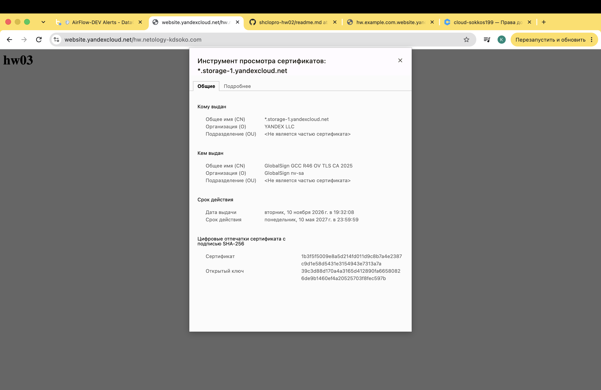

# Домашнее задание к занятию «Безопасность в облачных провайдерах»  

Используя конфигурации, выполненные в рамках предыдущих домашних заданий, нужно добавить возможность шифрования бакета.

---
## Задание 1. Yandex Cloud   

1. С помощью ключа в KMS необходимо зашифровать содержимое бакета:

 - создать ключ в KMS;
 - с помощью ключа зашифровать содержимое бакета, созданного ранее.
2. (Выполняется не в Terraform)* Создать статический сайт в Object Storage c собственным публичным адресом и сделать доступным по HTTPS:

 - создать сертификат;
 - создать статическую страницу в Object Storage и применить сертификат HTTPS;
 - в качестве результата предоставить скриншот на страницу с сертификатом в заголовке (замочек).

Полезные документы:

- [Настройка HTTPS статичного сайта](https://cloud.yandex.ru/docs/storage/operations/hosting/certificate).
- [Object Storage bucket](https://registry.terraform.io/providers/yandex-cloud/yandex/latest/docs/resources/storage_bucket).
- [KMS key](https://registry.terraform.io/providers/yandex-cloud/yandex/latest/docs/resources/kms_symmetric_key).

--- 
## Задание 2*. AWS (задание со звёздочкой)

Это необязательное задание. Его выполнение не влияет на получение зачёта по домашней работе.

**Что нужно сделать**

1. С помощью роли IAM записать файлы ЕС2 в S3-бакет:
 - создать роль в IAM для возможности записи в S3 бакет;
 - применить роль к ЕС2-инстансу;
 - с помощью bootstrap-скрипта записать в бакет файл веб-страницы.
2. Организация шифрования содержимого S3-бакета:

 - используя конфигурации, выполненные в домашнем задании из предыдущего занятия, добавить к созданному ранее бакету S3 возможность шифрования Server-Side, используя общий ключ;
 - включить шифрование SSE-S3 бакету S3 для шифрования всех вновь добавляемых объектов в этот бакет.

3. *Создание сертификата SSL и применение его к ALB:

 - создать сертификат с подтверждением по email;
 - сделать запись в Route53 на собственный поддомен, указав адрес LB;
 - применить к HTTPS-запросам на LB созданный ранее сертификат.

Resource Terraform:

- [IAM Role](https://registry.terraform.io/providers/hashicorp/aws/latest/docs/resources/iam_role).
- [AWS KMS](https://registry.terraform.io/providers/hashicorp/aws/latest/docs/resources/kms_key).
- [S3 encrypt with KMS key](https://registry.terraform.io/providers/hashicorp/aws/latest/docs/resources/s3_bucket_object#encrypting-with-kms-key).

Пример bootstrap-скрипта:

```
#!/bin/bash
yum install httpd -y
service httpd start
chkconfig httpd on
cd /var/www/html
echo "<html><h1>My cool web-server</h1></html>" > index.html
aws s3 mb s3://mysuperbacketname2021
aws s3 cp index.html s3://mysuperbacketname2021
```

### Правила приёма работы

Домашняя работа оформляется в своём Git репозитории в файле README.md. Выполненное домашнее задание пришлите ссылкой на .md-файл в вашем репозитории.
Файл README.md должен содержать скриншоты вывода необходимых команд, а также скриншоты результатов.
Репозиторий должен содержать тексты манифестов или ссылки на них в файле README.md.

---

## Решение. Задание 1, Yandex Cloud

Код: [terraform/](terraform/).

```bash
cd terraform
terraform init
terraform apply
```

### Что создано

| Ресурс | Где | Адрес |
|---|---|---|
| ключ `hw03-bucket` | KMS, AES_256 | `abj6osu68i9oo4mh28ac` |
| бакет `ksokolov-hw02-20261119` | Object Storage | SSE-KMS, ключ по умолчанию `abj6osu68i9oo4mh28ac` |
| объект `images.jpeg` | тот же бакет | чтение открыто, листинг закрыт |

Картинка: https://storage.yandexcloud.net/ksokolov-hw02-20261119/images.jpeg

### Проверка шифрования бакета

```bash
aws s3api get-bucket-encryption \
  --bucket ksokolov-hw02-20261119 \
  --endpoint-url https://storage.yandexcloud.net
```

```text
{
    "ServerSideEncryptionConfiguration": {
        "Rules": [
            {
                "ApplyServerSideEncryptionByDefault": {
                    "SSEAlgorithm": "aws:kms",
                    "KMSMasterKeyID": "abj6osu68i9oo4mh28ac"
                }
            }
        ]
    }
}
```

### Проверка объекта

```bash
aws s3api head-object \
  --bucket ksokolov-hw02-20261119 \
  --key images.jpeg \
  --endpoint-url https://storage.yandexcloud.net \
  --query '{SSE:ServerSideEncryption,Key:SSEKMSKeyId,Type:ContentType,Len:ContentLength}'
```

```text
{
    "SSE": "aws:kms",
    "Key": "abj6osu68i9oo4mh28ac",
    "Type": "image/jpeg",
    "Len": 24131
}
```

Публичный `curl -I` тоже отдаёт объект и заголовки шифрования:

```text
HTTP/2 200
content-type: image/jpeg
content-length: 24131
x-amz-server-side-encryption: aws:kms
x-amz-server-side-encryption-aws-kms-key-id: abj6osu68i9oo4mh28ac
```

### Пункт 2*. Статический сайт и HTTPS

Сделано через терминл (утилиту `yc`). Страницы лежат в [site/](site/). Бакет с шифрованием для этого не используется: свой домен вешается на бакет, имя которого совпадает с доменом.

Бакет `hw.netology-kdsoko.com`, чтение открыто, хостинг: главная `index.html`, ошибка `error.html`. Зона Cloud DNS `hw03-zone` (`dns80msblvrof2ijgem2`), публичная, `netology-kdsoko.com.`. CNAME `hw` → `hw.netology-kdsoko.com.website.yandexcloud.net`. Сервисному аккаунту `ajej1dh81lbvhnm4incf` выдана роль `dns.editor`.

Страница с замочком: https://website.yandexcloud.net/hw.netology-kdsoko.com



Имя в сертификате — `website.yandexcloud.net`, издатель GlobalSign. `curl` проверяет TLS (`ssl_verify=0`) и получает страницу:

```text
HTTP/2 200
content-type: text/html
content-length: 27

<html><h1>hw03</h1></html>
```

Тот же HTML по HTTP: http://hw.netology-kdsoko.com.website.yandexcloud.net


```bash
yc certificate-manager certificate delete --name hw03-site

yc certificate-manager certificate request \
  --folder-id b1gkfhvrdn8er82j6v3s \
  --name hw03-site \
  --challenge dns \
  --domains hw.netology-kdsoko.com

yc certificate-manager certificate get --name hw03-site --full
```

CNAME из `challenges` добавляется в зону `hw03-zone` как `_acme-challenge.hw`. Когда статус станет `ISSUED`:

```bash
yc storage bucket set-https \
  --name hw.netology-kdsoko.com \
  --certificate-id <id сертификата>
```
